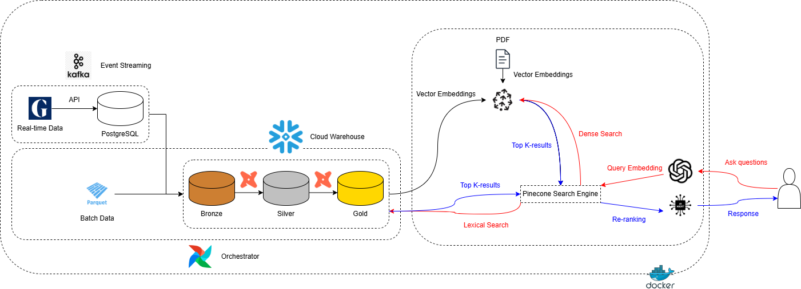

# Daily News AI Assistant

[](https://github.com/Dinhngoclam2906/fa-dae2-capstone-Dinh-Ngoc-Lam/actions/workflows/pr_ci.yml)


[](LICENSE)

Ask about the news in English or Vietnamese and get answers grounded in, and cited from,
~490k articles across The Guardian and 9 Vietnamese news sites, refreshed every 4 hours.

## Quick start

```bash
git clone https://github.com/Dinhngoclam2906/fa-dae2-capstone-Dinh-Ngoc-Lam.git && cd fa-dae2-capstone-Dinh-Ngoc-Lam
uv sync                         # Python 3.13, dependencies via uv
cp .env.example .env            # then fill in GCP_PROJECT, NEWS_SALT, OPENAI_API_KEY, PINECONE_API_KEY
gcloud auth application-default login
make test                       # unit tests, no credentials needed
make agent                      # Streamlit chat app (make cli for the terminal version)
```

`make help` lists every command (pipeline health check, dbt build, eval, local Docker
services). Without `make`, copy the command from the `Makefile`. Full setup is at the end
of this README.

## Overview
Daily News AI Assistant is a bilingual (English + Vietnamese) news chatbot built on an end-to-end data platform: ingestion from 10 news sources, a BigQuery warehouse modelled with dbt, and a **RAG (Retrieval-Augmented Generation)** agent that answers from those articles with citations. It combines:

- **Multilingual semantic search** (Pinecone index `news-articles-v2`, `gemini-embedding-2` article vectors): an English question finds Vietnamese articles too
- **Passage rescue** (BM25 over the top hits' full bodies): finds details deep inside an article that the vector doesn't see
- **"My sources" picker**: each user chooses which of the 10 sites to search
- **Question filters + recency**: a source or month stated in the question becomes a hard filter; "latest / mới nhất / this week" questions put recent articles first
- **LangGraph agent with 10 read-only tools** on BigQuery (keyword search, browse, full article, summaries, trending, freshness, coverage)
- **LLM `gpt-5.4-mini`** (chosen in `docs/llm_compare.md`), answering in the user's language
- **Persistent memory** (PostgreSQL checkpointer, in-memory fallback)

> **Migration note:** the warehouse moved from Snowflake to **BigQuery** (the Snowflake
> trial expired). Ingestion, dbt, the agent (`agent/core/`, since 2026-10-18) and the
> embeddings (since 2026-10-18) all run on GCP now. The original Guardian-only Pinecone
> index and the PDF-upload feature were removed on 2026-10-24. `PROGRESS_LOG.md` has the
> roadmap and phase status (local file).

**Status (2026-10-24):** the whole pipeline runs hands-off on GCP every 4 hours, and
493,470 articles from 10 sources are searchable. Measured running cost ≈ $0.29/day
(≈ $9/month, `docs/cost_report.md`), under a $10/month budget.

## Project Structure
### **1. Problem & Scope**:
The rapid pace of news publication requires frequent ingestion and analysis to stay relevant, while historical data provides context for long-term trends. Constraints include API rate limits, per-IP crawl throttling, data quality issues, warehouse query-cost budgets, and ensuring AI responses are grounded in accurate data.

### **2. Personas/Stakeholders and Primary Use Cases:**
- **Journalists:** Query news trends and sentiment for reporting.
- **Analysts:** Analyze historical news patterns for research.
- **General Users:** Ask natural language questions about news topics.
- **Use Cases:** Recent-news monitoring, historical trend analysis, sentiment analysis via AI chatbot.

### **3. In/Out of Scope:**
- **In Scope**: Frequent (near-real-time) news ingestion, batch processing of historical news, multi-source/bilingual data (English + Vietnamese), AI-driven insights, data quality validation.
- **Out of Scope**: True sub-minute streaming, social media integration, advanced ML model training.

### 4. Data Sources:
A multi-source, bilingual ingestion architecture: 10 sources, all kept current every 4 hours.

| Source (`source_name`) | Language | Collected via | Since | Articles (2026-10-24) |
|---|---|---|---|---|
| The Guardian (`guardian`) | en | HuggingFace archive + Guardian Content API | 1964 | 265,430 |
| Thanh Niên (`thanhnien`) | vi | sitemap crawler | 2026-01 | 74,359 |
| Tuổi Trẻ (`tuoitre`) | vi | sitemap crawler | 2026-01 | 65,187 |
| VietNamNet (`vietnamnet`) | vi | sitemap crawler | 2026-01 | 55,126 |
| VnEconomy (`vneconomy`) | vi | sitemap crawler | 2026-01 | 18,779 |
| Tuổi Trẻ English (`tuoitre_en`) | en | sitemap crawler | 2026-01 | 7,705 |
| VnEconomy English (`vneconomy_en`) | en | sitemap crawler | 2026-01 | 3,317 |
| VnExpress (`vnexpress`) | vi | RSS only (no archive) | ~2026-10-08 | 2,526 |
| VnExpress International (`vnexpress_en`) | en | RSS only | ~2026-10 | 701 |
| VietNamNet English (`vietnamnet_en`) | en | forward-only crawl | 2026-10-15 | 340 |

- **Incremental loading** - per-source cursor + dedupe sidecar, so nothing is re-crawled or re-processed.
- **Automated orchestration** - one **Cloud Workflows** DAG runs ingestion → dbt → embeddings every 4 hours (5.1.2.4), with source-freshness checks and email alerts. The Airflow DAGs remain for local/manual runs.

All sources land in one BigQuery table (`raw.raw_data`), tagged by `source_name` and `language` (`en`/`vi`).

### 5. Architecture Overview:

**High-level Diagram:**



> Note: the diagram above predates the BigQuery migration and still shows Snowflake. The
> pipeline described below is the current one.

```
Guardian API ─┐                                        ┌─> Bronze archive (raw HTML / API JSON, GCS Coldline)
9 VN sites ───┴─> Cloud Run ingestion jobs ─> GCS ─> BigQuery raw.raw_data (MERGE)
                                                         │
                                       dbt: stg_sf__guardian ─> obt_articles (+ freshness tests)
                                                         │
                     embed-sync: gemini-embedding-2 ─> vectors.article_embeddings / article_bodies ─> Pinecone news-articles-v2
                                                         │
                         Streamlit / CLI agent (LangGraph + gpt-5.4-mini) ─ dense search + passage rescue + BigQuery tools
```

#### **5.1. Data Pipeline:**

**5.1.1. Real-time / frequent-poll Pipeline:**

**5.1.1.1. Kafka Producer/Consumer** (`ingestion/streaming/`):
Purpose: poll the Guardian API and stream new articles through Kafka to PostgreSQL staging.
Key Features:
- State Tracking: PostgreSQL table tracks processed articles (avoid duplicates)
- Incremental Polling: Only fetches articles not yet seen
- Rate Limiting: Handles Guardian API limits (sleeps on 429 errors)
- Idempotent: Safe to re-run (won't create duplicates)

> Built and tested (milestone M03) but **unused in production**: frequent polling by the
> Cloud Run ingestion jobs (5.1.2.4) delivers new articles every 4 hours at no fixed cost,
> so Kafka lands data in local PostgreSQL only. Whether to remove it is still open.

**5.1.2. Batch & Backfill Data Processing:**

**5.1.2.1. Guardian - HF archive + API backfill** (`ingestion/hf_archive_to_parquet.py`, `guardian_api_backfill.py`):
- Downloads/cleans the HuggingFace historical archive and crawls the Guardian Content API for everything since, with a resumable cursor, lock file, and daily-quota handling.

**5.1.2.2. Vietnamese news crawler** (`ingestion/vn_news_backfill.py`, `run_vn_backfill_all.sh`):
- One crawler for all 9 Vietnamese sites and editions: sitemap-driven for Tuổi Trẻ, Thanh Niên, VnEconomy, VietNamNet and their English editions; RSS-only for VnExpress (no usable archive). Per-source resumable state, incremental Parquet flushing (every 100 articles), per-site concurrency and delays tuned for stability over raw speed.

**5.1.2.3. BigQuery loader** (`ingestion/load_raw_to_bigquery.py`):
- Parquet → GCS landing bucket → BigQuery staging table → `MERGE` into `raw.raw_data` (idempotent, dedupes on `article_id`). One command, `--source hf|api|vn`, handles all sources.
- Only stages/merges files pending since the last successful merge (tracked in a persistent `.pending_merge.<source>.json`), not the source's entire accumulated history - keeps `MERGE` cost proportional to what's new (~70x reduction measured vs. the naive full-wildcard approach).

**5.1.2.4. Automated pipeline: Cloud Workflows + Cloud Run Jobs** (`orchestration/workflows/news_pipeline.yaml`, `orchestration/workflows/deploy.sh`):
- **One DAG, `news-pipeline`, every 4 hours** (Cloud Scheduler `0 */4 * * *` UTC). It runs four Cloud Run Jobs one after another, each waiting for the previous one to finish:
  1. `guardian-ingestion` - Guardian Content API crawl + load (`infra/docker/Dockerfile.ingestion`, `run_ingestion_job.sh`). The Guardian `API_KEY` comes from **Secret Manager**.
  2. `vn-ingestion` - the 9 Vietnamese crawlers in parallel, then one load (`run_vn_ingestion_job.sh`). Running after Guardian means the two `MERGE`s into `raw.raw_data` never overlap.
  3. `dbt-build` - `dbt source freshness`, then `dbt build` (5.1.2.5).
  4. `embed-sync` - new article vectors to BigQuery and Pinecone (`infra/docker/Dockerfile.embed`, `agent/jobs/run_embed_job.sh`).
- Failure rules: a failed ingestion doesn't block the chain; a failed `dbt-build` skips `embed-sync`. The full chain takes ≈ 6 minutes; on average an article is searchable ≈ 2 hours after it is published.
- **Why Workflows, not Cloud Composer:** Workflows is pay-per-step (≈ $0/month here); Composer is an always-on Airflow environment (≈ $300-400/month even idle). One linear 4-step pipeline with no date backfills doesn't need Composer.
- **Article embeddings** (`agent/jobs/embed_articles.py`, `sync_vector_index.py`): every article in `marts.obt_articles` is embedded with `gemini-embedding-2` on Vertex AI (title + first 1,500 characters, 768 dims) into BigQuery `vectors.article_embeddings`, the source of truth, then copied at 512 dims into Pinecone `news-articles-v2`. The job also stores each article's full body in `vectors.article_bodies` for the agent's passage rescue. Incremental by `(article_id, content_hash)`, so new articles, edits and new sources are picked up automatically; a daily token cap bounds spend. Model choice: `docs/embedding_bakeoff.md`.
- Cloud Run Jobs start from a clean container every run, so `sync_job_state.py` round-trips the crawlers' cursors and the loader's pending-merge state through GCS (pull before, push after, even on a partial failure).
- Both crawlers keep their cursor on the still-filling tail (today + yesterday for Guardian, the current month for VN) instead of moving past it, so every run picks up articles published since the last one.
- **Bronze raw archive** (`raw_archive.py`): every article the crawlers store is also kept exactly as received (VN page HTML, Guardian API JSON) as gzipped JSON Lines in a Coldline bucket (`gs://<rawhtml bucket>/raw/source=<s>/fetch_date=<d>/`). Append-only, so a parser fix is an offline re-parse instead of a re-crawl.

**5.1.2.5. dbt build, monitoring and cost tracking** (`transform/Dockerfile`, `monitoring/`):
- `dbt-build` runs `dbt source freshness` (one check per source on `loaded_at`: warn 12h / error 24h for the big sources, 24h / 48h for the low-volume English editions), then `dbt build` **regardless**, so one stale source alerts without freezing the others.
- **Alerts:** Cloud Monitoring emails on any failed job execution, and on a `news-pipeline` run that fails or doesn't happen at all for 5 hours.
- **Daily cost report** (`monitoring/cost_report.py`, Cloud Run Job `cost-report`, 02:00 UTC): measured usage × list prices per service (BigQuery, Vertex AI, Cloud Run, GCS, Artifact Registry, Pinecone) plus OpenAI's billed cost, saved to `monitoring.cost_daily` and emailed. A GCP budget alert sits at $10/month. See `docs/cost_report.md`.
- Pipeline health is checked by **rows, not exit codes** (a "nothing to do" run exits 0): rows per source, articles without a vector, Pinecone vs. warehouse counts.

**5.1.3. dbt Transformation:**

The dbt (data build tool) layer transforms raw multi-source article data into **`obt_articles`**, a One Big Table the RAG agent reads, running on **BigQuery**:
- **Data Quality Validation** - Staging layer with comprehensive quality checks (source-aware: Guardian's fixed batch/realtime cutoff date vs. the VN crawler's crawl-relative rule)
- **One Big Table** - one row per article (current version) with the section group, source, language, word count, preview and a `content_hash` (the re-embedding signal) denormalised in. Fully derivable from raw, so `--full-refresh` is always safe
- **Incremental Loading** - each run replaces only the recent publication-month partitions, so BigQuery prunes the read (≈ 2-3 GB billed per build); a post-hook removes the stale copy when a publisher re-dates an old article into a new month
- **Bilingual sections** - `section_utils` buckets English and Vietnamese section names (incl. VietNamNet / VnExpress sub-sections) into 12 groups; an empty section maps to `Other` instead of dropping the article
- **Local time** - storage stays UTC; display-only `*_local` columns render `Asia/Ho_Chi_Minh` wall-clock time
- **Star schema, frozen** - the original Kimball model (`dim_articles` with SCD Type 2, `dim_sections`, `dim_date`, `fct_articles`) was frozen on 2026-10-18 and copied to the `marts_archive` dataset. The agent only ever needed a flat article table, and the star schema's inner joins silently dropped articles with an empty section. See `docs/decision_obt_serving_layer.md`
- **Automated Testing** - 40+ data quality tests, plus SQLFluff lint and `dbt test` in PR CI

#### **5.2. Tech Stacks:**

- **Python:** Flexible for data ingestion and processing (requests, polars, BeautifulSoup + lxml).
- **PostgreSQL:** Local staging for rapid development, and the agent's conversation-memory checkpointer.
- **BigQuery:** Scalable, serverless cloud warehouse for analytics (migrated from Snowflake), and the store for article vectors and bodies.
- **dbt:** Industry-standard for data transformations (`dbt-bigquery` adapter).
- **Cloud Workflows + Cloud Scheduler + Cloud Run Jobs:** the production pipeline (orchestration, trigger, compute), all pay-per-use to stay inside a $5-10/month budget. Secret Manager holds the API keys; Cloud Monitoring alerts on failures.
- **Vertex AI (`gemini-embedding-2`):** multilingual article and query embeddings.
- **Pinecone:** serverless vector index for the agent's semantic search.
- **LangGraph + LangChain:** the conversational agent and its tools.
- **OpenAI (`gpt-5.4-mini`):** the chat model.
- **Kafka:** Real-time streaming primitive for the Guardian API path (built, unused in production).
- **Airflow:** Local/manual orchestration of the ingestion + dbt steps (validated end-to-end; production uses Cloud Workflows).
- **GitHub Actions:** PR CI (`dbt debug` → `deps` → SQLFluff → `dbt test`) against BigQuery, authenticated **keylessly** via Workload Identity Federation as a read-only `ci-runner` service account; a required status check on `main`.

#### **ERD:**

The live path is `raw_data` → `stg_sf__guardian` → `obt_articles` → `vw_articles_search_optimized`. The image and the `dim_*` / `fct_articles` tables below show the **frozen** star schema (archived in `marts_archive`, no longer built).


```dbml
Table raw_data {
  article_id string [pk, unique]
  crawl_timestamp timestamp
  web_publication_date timestamp
  web_title string
  body_text text
  web_url string
  section_name string
  data_source string  // 'batch' | 'realtime'
  source_name string  // 'guardian' | 'tuoitre' | 'thanhnien' | 'vneconomy' | 'vietnamnet' | 'vnexpress' | '<site>_en'
  language string      // 'en' | 'vi'
  loaded_at timestamp
  Note: 'Raw multi-source articles, loaded via load_raw_to_bigquery.py'
}

Table stg_sf__guardian {
  article_id string [pk]
  crawl_timestamp timestamp [pk]
  web_publication_date timestamp
  web_title string
  body_text text
  web_url string
  section_name string
  data_source string
  source_name string
  language string
  loaded_at timestamp
  has_valid_title boolean
  has_valid_url boolean
  has_valid_content boolean
  has_valid_section boolean
  has_consistent_data_source boolean
  processed_at timestamp
  processing_source string
  Note: 'Staging: Cleaned raw with quality flags (source-aware consistency check)'
}

Table dim_date {
  date_id date [pk]
  year integer
  month integer
  day integer
  day_of_week integer
  quarter integer
  fiscal_quarter string
  is_weekend boolean
  is_holiday boolean
  holiday_name string
  dbt_updated_at timestamp
  Note: 'Date dimension with UK holidays (Guardian-focused); 100k-day spine via GENERATE_DATE_ARRAY'
}

Table dim_sections {
  section_key string [pk, unique]
  section_name string
  section_group string
  dbt_updated_at timestamp
  Note: 'Section dimension with bucketing macro (English-keyword grouping; VN sections mostly bucket to Other today)'
}

Table dim_articles {
  article_id string [pk]
  valid_from timestamp [pk]
  web_title string
  web_url string
  section_key string
  data_source string
  valid_to timestamp
  is_current boolean
  version_surrogate_key string
  content_change_hash string
  change_type string
  crawl_timestamp timestamp
  dbt_updated_at timestamp
  Note: 'SCD Type 2: Versions on title/URL/section/body changes, partitioned by valid_from (month)'
}

Table fct_articles {
  article_event_hk string [pk, unique]
  article_id string
  crawl_timestamp timestamp
  web_publication_date timestamp
  attribute_hash string
  web_title string
  body_text text
  data_source string
  date_id date
  section_key string
  is_current boolean
  valid_content integer
  web_url string
  loaded_at timestamp
  dbt_updated_at timestamp
  Note: 'Fact: Article events (granular per crawl), partitioned by web_publication_date (month)'
}

Table obt_articles {
  article_id string [pk, unique]
  web_title string
  body_text text
  preview string
  word_count integer
  web_url string
  web_publication_date timestamp
  section_name string
  section_group string
  source_name string
  language string
  data_source string
  content_hash string
  crawl_timestamp timestamp
  loaded_at timestamp
  dbt_updated_at timestamp
  Note: 'LIVE serving table (OBT): one row per article, partitioned by web_publication_date (month), clustered by source_name, section_group, language'
}

Ref: stg_sf__guardian.article_id - obt_articles.article_id

// Relationships (frozen star schema)
Ref: stg_sf__guardian.article_id > dim_articles.article_id
Ref: stg_sf__guardian.section_name > dim_sections.section_key
Ref: fct_articles.date_id > dim_date.date_id
Ref: fct_articles.section_key > dim_sections.section_key
Ref: fct_articles.article_id > dim_articles.article_id
Ref: dim_articles.section_key > dim_sections.section_key
```

#### **5.3. AI Agent Architecture**

> One implementation in `agent/core/` behind both front ends (`app.py` Streamlit,
> `cli_agent.py` terminal). Every BigQuery query is parameterised, date-windowed (partition
> pruning) and capped by `maximum_bytes_billed` (600 MB). Since 2026-10-20 the automatic
> retrieval is **dense search only**: the eval showed the old hybrid recipe (dense + keyword
> + FlashRank rerank) pushed good hits out of the top 5 (5.4). Keyword search is still a
> tool the LLM can call for exact names and numbers. Demo mode in the app runs the old
> hybrid pipeline for comparison.

```
┌─────────────────────────────────────────────────────────────────┐
│                         USER QUERY                              │
│       "Tin mới nhất về giá vàng" / "Latest on UK climate policy"│
└────────────────────────────┬────────────────────────────────────┘
                             ▼
┌─────────────────────────────────────────────────────────────────┐
│                    SMART QUERY ROUTING                          │
│  • Greetings / small talk → direct reply (no retrieval)         │
│  • "those articles…" → reuse the previous turn's sources        │
│  • News questions → retrieval                                   │
└────────────────────────────┬────────────────────────────────────┘
                             ▼
┌─────────────────────────────────────────────────────────────────┐
│                 QUERY UNDERSTANDING (rules)                     │
│  • Source or month / year in the question → hard filter         │
│  • "latest / mới nhất / this week" → recent articles first      │
└────────────────────────────┬────────────────────────────────────┘
                             ▼
┌─────────────────────────────────────────────────────────────────┐
│          DENSE SEARCH (Pinecone news-articles-v2)               │
│  • gemini-embedding-2 query vector, all 10 sources, 2 languages │
│  • top 30 articles, filters applied inside Pinecone             │
└────────────────────────────┬────────────────────────────────────┘
                             ▼
┌─────────────────────────────────────────────────────────────────┐
│          PASSAGE RESCUE (BigQuery vectors.article_bodies)       │
│  • BM25 over the 30 full bodies (25 MB per lookup)              │
│  • keep the dense top 4, fill the rest by best passage          │
│  • add each article's best passage to its context               │
└────────────────────────────┬────────────────────────────────────┘
                             ▼
┌─────────────────────────────────────────────────────────────────┐
│                    LANGGRAPH AGENT                              │
│                                                                 │
│  ┌──────────────┐    ┌──────────────┐    ┌──────────────────┐   │
│  │   RETRIEVE   │───▶│   CHATBOT    │◀──▶│      TOOLS       │   │
│  │ (above; the  │    │ gpt-5.4-mini │    │ 10, read-only:   │   │
│  │  context is  │    │ cites title, │    │ keyword search,  │   │
│  │  per turn,   │    │ source, date │    │ semantic search, │   │
│  │  not stored  │    │ + URL; user's│    │ browse, article, │   │
│  │  in history) │    │ language     │    │ summaries, ...   │   │
│  └──────────────┘    └──────────────┘    └──────────────────┘   │
│                                                                 │
│  Memory: PostgreSQL checkpointer (last 6 turns sent to the LLM) │
└────────────────────────────┬────────────────────────────────────┘
                             ▼
                    ┌──────────────────┐
                    │  FINAL RESPONSE  │
                    │ • Grounded       │
                    │ • Cited sources  │
                    │ • EN or VI       │
                    └──────────────────┘
```

**My sources:** the app's sidebar lets each user pick the sites they read (all 10 by
default, with *All / Tiếng Việt / English* presets; `cli_agent.py --sources tuoitre,vnexpress`
in the terminal). The choice scopes every search, the automatic retrieval and every tool,
unless the question itself names a site ("what did the Guardian write…"), which still wins.

Public-demo safety: a per-session question limit (30/hour), per-query BigQuery byte caps,
3-second timeouts with one retry on the embedding and Pinecone calls (BigQuery and the LLM
have their own timeouts), and a fallback answer when a
retrieval step fails or the agent hits its tool-step limit.

#### **5.4. Evaluation**

Each change to retrieval was measured on real questions, through the real code, against the full corpus:

| Eval | What it showed | Doc |
|---|---|---|
| Embedding bake-off | `gemini-embedding-2` beat OpenAI `text-embedding-3-small` and e5, incl. English → Vietnamese questions | `docs/embedding_bakeoff.md` |
| Retrieval refresh (130 questions) | known-item recall@5: old Guardian-only hybrid **0.22** → v2 dense **0.95** (agent default 0.96); topical precision@5 0.31 → 0.86. Rerank and keyword interleave hurt | `docs/eval_refresh.md` |
| Hard set (95 questions, the regression benchmark) | question filters: constraint compliance 0.46 → 0.98; passage rescue: deep-detail found@5 0.50 → 0.70 | `docs/hard_eval.md` |
| LLM comparison (5 models) | `gpt-5.4-mini` gave the best answers (~$7 per 1,000 turns) | `docs/llm_compare.md` |

The original 2026-01 eval (`agent/legacy/eval_2026_01/`, 4 strategies on the Guardian-only index) is kept, frozen, as the first baseline. Bugs, incidents and lessons are collected in `docs/lessons_learned.md`.

---

**Project Structure** (abridged - omits `__pycache__`, `.venv`, `target`, `dbt_packages`, `logs`).
One folder per pipeline component, in data-flow order. Old paths (before 2026-10-24) map to
these in `docs/repo_layout.md`.
```
fa-dae2-capstone-Dinh-Ngoc-Lam/
├── ingestion/                  # 1. collect: crawlers, BigQuery loader, Bronze archive, Cloud Run Job entrypoints
│   ├── legacy/                 #    Snowflake-era collector / loader
│   └── streaming/              #    Kafka producer / consumer (unused in production)
├── transform/                  # 2. model: the dbt project (BigQuery), its Dockerfile = dbt-build job image
│   ├── models/                 #    01_staging -> 02_intermediate -> 03_mart (obt_articles) + monitoring
│   ├── macros/  tests/         #    section_utils, generate_news_hash, ...; custom data tests
│   └── .dbt/profiles.yml       #    the only dbt profile (use --profiles-dir .dbt)
├── agent/                      # 3. serve: the RAG agent
│   ├── core/                   #    config, bq, articles, text, retrieval, passages, tools, agent, llm, memory
│   ├── app.py / cli_agent.py   #    Streamlit and terminal front ends over core/
│   ├── jobs/                   #    embed-sync job: embed_articles, sync_vector_index, run_embed_job.sh
│   ├── eval/                   #    current evals: hard_eval (benchmark), retrieval_eval, time_eval, llm_compare
│   └── legacy/eval_2026_01/    #    FROZEN first eval (Guardian-only v1 index) + its results
├── orchestration/
│   ├── workflows/              # production DAG: Cloud Workflows news_pipeline.yaml + deploy.sh (schedules)
│   └── airflow/dags/           # local/manual Airflow DAGs: guardian_ingestion, capstone_dbt_orchestration
├── monitoring/                 # daily cost report (cost_report.py, deploy script)
├── infra/
│   ├── docker/                 # Dockerfile.ingestion / .embed / .cost (the Cloud Run Job images)
│   └── local/                  # docker compose: agent-memory Postgres, Kafka, Airflow; Dockerfile.airflow; sql/init.sql
├── tests/                      # pytest unit tests (no network): question parsing, passage rescue, retrieval
├── docs/                       # reports, decisions, eval results, lessons_learned; images/ (diagram + ERD)
├── data/                       # local working data (git-ignored; the crawlers' cwd-relative state lives here)
├── .claude/skills/             # runbooks: check-pipeline, deploy-job-image, log-update
├── .github/workflows/pr_ci.yml # CI: unit tests, SQLFluff, dbt test on BigQuery (keyless WIF)
├── Makefile                    # make help: common commands
├── pyproject.toml / uv.lock    # uv-managed dependencies (transform/ is a uv workspace member)
├── requirements.txt            # Airflow-image dependency subset
├── .env.example                # every setting, with defaults
└── LICENSE                     # MIT
```

**Setup Instructions:**

**1. Clone Repository:**
```
git clone https://github.com/Dinhngoclam2906/fa-dae2-capstone-Dinh-Ngoc-Lam/
```

**2. Install Dependencies:**
```
uv sync
```

**3. Configure and authenticate** (copy `.env.example` to `.env` and fill it in; BigQuery/GCS/Vertex AI use Application Default Credentials - no service-account key exists):
```
gcloud auth login
gcloud config set project <your GCP project id>
gcloud auth application-default login
```

**4. Start Local Docker Services** (in `infra/local/`, split by concern - start only what you need; run from the repo root):
```
make memory-db     # agent memory (Postgres, port 5433); without it the agent keeps history in memory
make kafka         # kafka + kafdrop + airflow metadata pg
make airflow       # airflow
make down          # stop them all
```
The targets run `docker compose --project-directory . -f infra/local/<file>.yml ...`, so paths,
`.env` and the Compose project name (and with it the existing volumes) stay those of the repo root.

**5. Run Ingestion:**

> In production, ingestion runs unattended every 4 hours in the `news-pipeline` workflow
> (5.1.2.4). The commands below are for local development, manual catch-up runs, or debugging.

Guardian (batch + API backfill):
```
uv run python ingestion/hf_archive_to_parquet.py
uv run python ingestion/guardian_api_backfill.py
```

Vietnamese news (resumable):
```
bash ingestion/run_vn_backfill_all.sh
```

Load everything to BigQuery:
```
uv run python ingestion/load_raw_to_bigquery.py --source hf
uv run python ingestion/load_raw_to_bigquery.py --source api
uv run python ingestion/load_raw_to_bigquery.py --source vn --max-bytes-billed 5000000000
```

Real-time (Guardian API → Kafka → PostgreSQL only, unused in production):
```
uv run python ingestion/streaming/kafka_producer.py --once --max-articles 100
uv run python ingestion/streaming/kafka_consumer.py --once
```

**6. Build the warehouse (dbt, from `transform/`):**

In production this runs every 4 hours as the `dbt-build` step of the workflow (5.1.2.5).
Locally, always pass `--profiles-dir .dbt` (the project's only profile) and load `.env`.
`GCP_PROJECT` and `NEWS_SALT` are required and have no defaults:
```
uv run --env-file ../.env dbt deps --profiles-dir .dbt
uv run --env-file ../.env dbt source freshness --profiles-dir .dbt
uv run --env-file ../.env dbt build --profiles-dir .dbt
```

**7. Run the Agent** (from the repo root):
```
make agent         # = uv run --env-file .env streamlit run agent/app.py
make cli           # = uv run --env-file .env python agent/cli_agent.py --stats
```

Tests and the regression benchmark:
```
make test          # unit tests (also run in CI on every push and PR)
make eval          # hard question set through the real retrieval (stages in its docstring)
make check         # pipeline health by rows: workflow runs, jobs, rows per source, vectors
```

**8. Verify Data:**
Check `raw.raw_data` in BigQuery (row counts and `MAX(loaded_at)` per `source_name`), the `staging` / `marts` / `monitoring` datasets after a dbt build, and that `vectors.article_embeddings` and the Pinecone index match `marts.obt_articles`.

## License

[MIT](LICENSE) © 2026 Dinh Ngoc Lam
