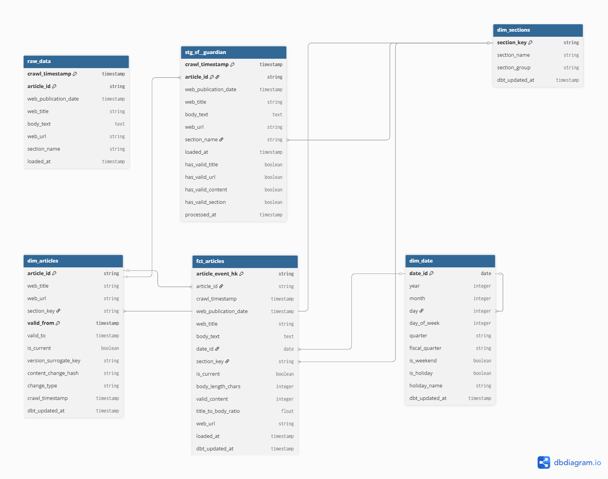

# Daily News AI Assistant

## Overview
Daily News AI Assistant is an intelligent chatbot powered by a **hybrid RAG (Retrieval-Augmented Generation)** architecture that combines:

- **Dense Semantic Search** (Pinecone vector database) - Understanding meaning and context
- **Lexical SQL Search** (warehouse keyword matching) - Exact phrase and entity matching
- **FlashRank Re-ranking** - Relevance optimization
- **LangGraph Agent Framework** - Conversational AI with tool calling
- **Persistent Memory** (PostgreSQL) - Conversation history across sessions

> **Migration note:** the data warehouse moved from Snowflake to **BigQuery** (the
> Snowflake trial expired). The dbt transformation layer and raw ingestion already run
> on BigQuery. The AI agent's SQL tool layer (`ai_agents/capstone_tool_calling_agent.py`)
> is intentionally still frozen on the old Snowflake-based code pending a later
> migration phase - see `PROGRESS_LOG.md` for the full roadmap and current phase status.

## Project Structure
### **1. Problem & Scope**:
The rapid pace of news publication requires frequent ingestion and analysis to stay relevant, while historical data provides context for long-term trends. Constraints include API rate limits, per-IP crawl throttling, data quality issues, warehouse query-cost budgets, and ensuring AI responses are grounded in accurate data.

### **2. Personas/Stakeholders and Primary Use Cases:**
- **Journalists:** Query news trends and sentiment for reporting.
- **Analysts:** Analyze historical news patterns for research.
- **General Users:** Ask natural language questions about news topics.
- **Use Cases:** Recent-news monitoring, historical trend analysis, sentiment analysis via AI chatbot.

### **3. In/Out of Scope:**
- **In Scope**: Frequent (near-real-time) news ingestion, batch processing of historical news, multi-source/bilingual data (English + Vietnamese), AI-driven insights, data quality validation.
- **Out of Scope**: True sub-minute streaming, social media integration, advanced ML model training.

### 4. Data Sources:
A multi-source, bilingual ingestion architecture:

- **Guardian (English)** - HuggingFace historical archive (~87k articles) + Guardian Content API backfill/catch-up crawler, 1964 → present.
- **Vietnamese news** - Tuổi Trẻ, Thanh Niên, and VnEconomy, crawled via a sitemap-driven resumable crawler (`scripts/batch_data/vn_news_backfill.py`), backfilled from 2026-01 and kept current every 4 hours.
- **Incremental Loading** - Per-source cursor + dedupe sidecar to avoid re-crawling/re-processing.
- **Automated Orchestration** - Guardian and Vietnamese ingestion run unattended every 4 hours and `dbt build` runs daily, all via **Cloud Scheduler + Cloud Run Jobs** (serverless, scale-to-zero), with source-freshness checks and an email alert on any failed run. The Airflow DAGs remain available for local/manual runs.

All sources land in one BigQuery table (`raw.raw_data`), tagged by `source_name` (`guardian`/`tuoitre`/`thanhnien`/`vneconomy`) and `language` (`en`/`vi`).

### 5. Architecture Overview:

**High-level Diagram:**


> Note: the diagram above predates the BigQuery migration and still shows Snowflake -
> refresh it to match the pipeline described below when there's time.

#### **5.1. Data Pipeline:**

**5.1.1. Real-time / frequent-poll Pipeline:**

**5.1.1.1. Kafka Producer/Consumer** (`scripts/real_time_data/`):
Purpose: poll the Guardian API and stream new articles through Kafka to PostgreSQL staging.
Key Features:
- State Tracking: PostgreSQL table tracks processed articles (avoid duplicates)
- Incremental Polling: Only fetches articles not yet seen
- Rate Limiting: Handles Guardian API limits (sleeps on 429 errors)
- Idempotent: Safe to re-run (won't create duplicates)

> This path currently lands data in local PostgreSQL only - it has not yet been pointed
> at BigQuery (see `PROGRESS_LOG.md`, Phase 2). The DAG's real-time tasks are disabled;
> the actively-running ingestion today is the batch/backfill crawlers below.

**5.1.2. Batch & Backfill Data Processing:**

**5.1.2.1. Guardian - HF archive + API backfill** (`scripts/batch_data/hf_archive_to_parquet.py`, `guardian_api_backfill.py`):
- Downloads/cleans the HuggingFace historical archive and crawls the Guardian Content API for everything since, with a resumable cursor, lock file, and daily-quota handling.

**5.1.2.2. Vietnamese news crawler** (`scripts/batch_data/vn_news_backfill.py`, `run_vn_backfill_all.sh`):
- Sitemap-driven crawler for Tuổi Trẻ / Thanh Niên / VnEconomy. Per-source resumable state, incremental Parquet flushing (every 100 articles, not just at month-end), concurrency tuned for stability over raw speed.

**5.1.2.3. BigQuery loader** (`scripts/batch_data/load_raw_to_bigquery.py`):
- Parquet → GCS landing bucket → BigQuery staging table → `MERGE` into `raw.raw_data` (idempotent, dedupes on `article_id`). One command, `--source hf|api|vn`, handles all sources.
- Only stages/merges files pending since the last successful merge (tracked in a persistent `.pending_merge.<source>.json`), not the source's entire accumulated history - keeps `MERGE` cost proportional to what's new (~70x reduction measured vs. the naive full-wildcard approach).

**5.1.2.4. Automated recurring ingestion** (`Dockerfile.ingestion`, `scripts/batch_data/run_ingestion_job.sh`, `run_vn_ingestion_job.sh`, `sync_job_state.py`):
- One minimal image (just the crawlers + BigQuery loader, not the full project) backs two Cloud Run Jobs on **Cloud Scheduler** crons, authenticated via OAuth as the `dbt-runner` service account calling the Cloud Run Jobs Admin API directly - no persistent VM or Airflow scheduler process required:
  - `guardian-ingestion` (`0 */4 * * *` UTC) - Guardian Content API crawl + load. The Guardian `API_KEY` comes from **Secret Manager** (`guardian-api-key`), not a plain env var.
  - `vn-ingestion` (`15 */4 * * *` UTC, offset so the two `MERGE`s into `raw.raw_data` never overlap) - the three VN crawlers in parallel, then one load.
- Both crawlers keep their cursor on the still-filling tail (today + yesterday for Guardian, the current month for VN) instead of moving past it, so every run picks up articles published since the last one; the downstream `MERGE` dedupes on `article_id`.
- Cloud Run Jobs start from a clean container every invocation (no local disk persists between runs), so `sync_job_state.py` round-trips the crawler's cursor file and the loader's pending-merge state through a GCS prefix (pull before the run, push after - always, even on a partial failure, so an advanced cursor is never lost).
- Verified end-to-end: a forced trigger produces a real Cloud Run execution run by the `dbt-runner` service account (confirmed via `gcloud run jobs executions list`), not a manual one.

**5.1.2.5. Automated dbt + monitoring** (`capstone_dbt_project/Dockerfile`):
- Cloud Run Job `dbt-build` runs daily at `30 0 * * *` UTC (07:30 Vietnam time): `dbt source freshness` (Guardian + one check per VN site, warn 12h / error 24h on `loaded_at`), then `dbt build`. A stale source fails the run - which is what catches an ingestion job that "succeeds" while landing nothing - but the build still runs, so one stale source doesn't freeze the others.
- A Cloud Monitoring alert policy emails on any failed execution of `guardian-ingestion`, `vn-ingestion`, or `dbt-build`.

**5.1.3. dbt Transformation:**

The dbt (data build tool) layer transforms raw multi-source article data into a **star schema** optimized for analytics and RAG retrieval, running on **BigQuery**:
- **Data Quality Validation** - Staging layer with comprehensive quality checks (source-aware: Guardian's fixed batch/realtime cutoff date vs. the VN crawler's crawl-relative rule)
- **SCD Type 2** - Tracks article version history (title/content changes)
- **Incremental Loading** - Efficient processing of only new/changed data, partitioned by month
- **Bilingual sections** - `section_utils` buckets English and Vietnamese section names into the same groups; `fct_articles` carries `source_name` / `language`
- **Local time** - storage stays UTC; display-only `*_local` columns render `Asia/Ho_Chi_Minh` wall-clock time
- **Star Schema** - Dimensions + Facts for fast analytical queries
- **Automated Testing** - 40+ data quality tests

#### **5.2. Tech Stacks:**

- **Python:** Flexible for data ingestion and processing (requests, polars, BeautifulSoup).
- **PostgreSQL:** Local staging for rapid development, and the agent's conversation-memory checkpointer.
- **BigQuery:** Scalable, serverless cloud warehouse for analytics (migrated from Snowflake).
- **dbt:** Industry-standard for data transformations (`dbt-bigquery` adapter).
- **Kafka:** Real-time streaming primitive for the Guardian API path (currently lands in PostgreSQL only, not yet wired to BigQuery).
- **Cloud Scheduler + Cloud Run Jobs:** Serverless cron for the recurring Guardian + Vietnamese ingestion and the daily dbt build in production (chosen over an always-on VM or Cloud Composer to stay under the $5-10/mo BigQuery/GCP budget cap). Secret Manager holds the Guardian API key; Cloud Monitoring alerts on failures.
- **Airflow:** Local/manual orchestration of the ingestion + dbt steps (validated end-to-end; production uses Cloud Run).
- **LangGraph/Pinecone:** Enables conversational AI with grounded responses.
- **OpenAI**: LLM + embeddings API.
- **GitHub Actions:** CI (currently still configured for Snowflake; BigQuery CI auth needs Workload Identity Federation - not yet set up).

#### **ERD:**



```dbml
Table raw_data {
  article_id string [pk, unique]
  crawl_timestamp timestamp
  web_publication_date timestamp
  web_title string
  body_text text
  web_url string
  section_name string
  data_source string  // 'batch' | 'realtime'
  source_name string  // 'guardian' | 'tuoitre' | 'thanhnien' | 'vneconomy'
  language string      // 'en' | 'vi'
  loaded_at timestamp
  Note: 'Raw multi-source articles, loaded via load_raw_to_bigquery.py'
}

Table stg_sf__guardian {
  article_id string [pk]
  crawl_timestamp timestamp [pk]
  web_publication_date timestamp
  web_title string
  body_text text
  web_url string
  section_name string
  data_source string
  source_name string
  language string
  loaded_at timestamp
  has_valid_title boolean
  has_valid_url boolean
  has_valid_content boolean
  has_valid_section boolean
  has_consistent_data_source boolean
  processed_at timestamp
  processing_source string
  Note: 'Staging: Cleaned raw with quality flags (source-aware consistency check)'
}

Table dim_date {
  date_id date [pk]
  year integer
  month integer
  day integer
  day_of_week integer
  quarter integer
  fiscal_quarter string
  is_weekend boolean
  is_holiday boolean
  holiday_name string
  dbt_updated_at timestamp
  Note: 'Date dimension with UK holidays (Guardian-focused); 100k-day spine via GENERATE_DATE_ARRAY'
}

Table dim_sections {
  section_key string [pk, unique]
  section_name string
  section_group string
  dbt_updated_at timestamp
  Note: 'Section dimension with bucketing macro (English-keyword grouping; VN sections mostly bucket to Other today)'
}

Table dim_articles {
  article_id string [pk]
  valid_from timestamp [pk]
  web_title string
  web_url string
  section_key string
  data_source string
  valid_to timestamp
  is_current boolean
  version_surrogate_key string
  content_change_hash string
  change_type string
  crawl_timestamp timestamp
  dbt_updated_at timestamp
  Note: 'SCD Type 2: Versions on title/URL/section/body changes, partitioned by valid_from (month)'
}

Table fct_articles {
  article_event_hk string [pk, unique]
  article_id string
  crawl_timestamp timestamp
  web_publication_date timestamp
  attribute_hash string
  web_title string
  body_text text
  data_source string
  date_id date
  section_key string
  is_current boolean
  valid_content integer
  web_url string
  loaded_at timestamp
  dbt_updated_at timestamp
  Note: 'Fact: Article events (granular per crawl), partitioned by web_publication_date (month)'
}

// Relationships (star schema)
Ref: stg_sf__guardian.article_id > dim_articles.article_id
Ref: stg_sf__guardian.section_name > dim_sections.section_key
Ref: fct_articles.date_id > dim_date.date_id
Ref: fct_articles.section_key > dim_sections.section_key
Ref: fct_articles.article_id > dim_articles.article_id
Ref: dim_articles.section_key > dim_sections.section_key
```

#### **5.3. AI Agent Architecture**

> As noted above, the agent's SQL tool currently still targets the old Snowflake-based
> layer (frozen, not yet repointed at BigQuery) - the box below reflects the live code,
> not the current data platform.

```
┌─────────────────────────────────────────────────────────────────┐
│                         USER QUERY                              │
│              "What's the latest on climate change?"             │
└────────────────────────────┬────────────────────────────────────┘
                             │
                             ▼
┌─────────────────────────────────────────────────────────────────┐
│                    SMART QUERY ROUTING                          │
│  • Greetings/meta questions → Direct response (no retrieval)    │
│  • Factual queries → Hybrid retrieval pipeline                  │
└────────────────────────────┬────────────────────────────────────┘
                             │
                   ┌─────────┴─────────┐
                   │                   │
                   ▼                   ▼
     ┌──────────────────────┐  ┌──────────────────────┐
     │   DENSE SEARCH       │  │    SQL SEARCH        │
     │   (Pinecone)         │  │    (Snowflake)       │
     │                      │  │                      │
     │ • Semantic matching  │  │ • Keyword extraction │
     │ • 2 namespaces:      │  │ • Multi-keyword OR   │
     │   - guardian_articles│  │ • Optimized view     │
     │   - user_documents   │  │ • Full-text search   │
     │ • K=10 results       │  │ • Limit=10 results   │
     └──────────┬───────────┘  └──────────┬───────────┘
                │                         │
                └────────┬────────────────┘
                         ▼
           ┌─────────────────────────┐
           │   MERGE & DEDUPLICATE   │
           │                         │
           │ • Remove duplicates     │
           │ • By article_id         │
           │ • By text similarity    │
           └────────────┬────────────┘
                        ▼
           ┌─────────────────────────┐
           │   FLASHRANK RERANKER    │
           │                         │
           │ • Local model (fast)    │
           │ • Relevance scoring     │
           │ • Top-K selection       │
           │ • Skip if <3 results    │
           └────────────┬────────────┘
                        ▼
           ┌─────────────────────────┐
           │   CONTEXT FORMATTING    │
           │                         │
           │ • Source labeling       │
           │ • Metadata enrichment   │
           │ • Retrieval stats       │
           └────────────┬────────────┘
                        ▼
┌─────────────────────────────────────────────────────────────────┐
│                    LANGGRAPH AGENT                              │
│                                                                 │
│  ┌──────────────┐    ┌──────────────┐    ┌──────────────┐       │
│  │   RETRIEVE   │───▶│   CHATBOT    │───▶│    TOOLS    │       │
│  │              │    │              │    │              │       │
│  │ • Query      │    │ • GPT-4o     │    │ • SQL search │       │
│  │   routing    │    │   mini       │    │ • Trending   │       │
│  │ • Hybrid     │    │ • Context    │    │ • Summaries  │       │
│  │   search     │    │   aware      │    │ • Metadata   │       │
│  │ • Context    │    │ • Tool       │    │              │       │
│  │   building   │    │   calling    │    │              │       │
│  └──────────────┘    └──────────────┘    └──────────────┘       │
│                                                                 │
│  Memory: PostgreSQL (conversation history, checkpoints)         │
└────────────────────────────┬────────────────────────────────────┘
                             ▼
                    ┌──────────────────┐
                    │  FINAL RESPONSE  │
                    │                  │
                    │ • Grounded       │
                    │ • Cited sources  │
                    │ • Conversational │
                    └──────────────────┘
```

---

**Project Structure** (abridged - omits `__pycache__`, `.venv`, `target`, `dbt_packages`, `logs`):
```
fa-dae2-capstone-Dinh-Ngoc-Lam/
├── .github/workflows/
│   └── pr_ci.yml                                  # PR CI: lint + dbt test (still Snowflake-configured)
├── ai_agents/                                      # RAG agent (frozen on Snowflake pending migration)
│   ├── app.py / app_demo.py / cli_agent.py         # Three entrypoints, same pipeline
│   ├── capstone_tool_calling_agent.py              # Snowflake tool-calling layer
│   ├── data_ingestion_to_pinecone.py               # Snowflake → Pinecone embedding pipeline
│   ├── document_upload_ingestion.py + services/    # User-uploaded doc ingestion
│   ├── evaluation.py / baseline_systems.py         # Retrieval strategy comparison + eval harness
│   └── label_ground_truth*.py / visualize_results.py
├── capstone_dbt_project/                           # dbt project (BigQuery)
│   ├── .dbt/profiles.yml                           # the single dbt profile (use --profiles-dir .dbt)
│   ├── Dockerfile                                  # dbt-build Cloud Run Job image
│   ├── macros/                                     # generate_news_hash, section_utils, generate_schema_name
│   ├── models/
│   │   ├── 01_staging/                             # stg_sf__guardian, _sources.yml
│   │   ├── 02_intermediate/                        # int_article_metrics (ephemeral)
│   │   ├── 03_mart/                                # dim_date, dim_sections, dim_articles, fct_articles, vw_articles_search_optimized
│   │   └── monitoring/                             # news_freshness
│   ├── tests/                                      # assert_data_source_consistency, test_scd_content_changes
│   ├── dbt_project.yml
│   └── packages.yml                                # dbt_utils
├── dags/
│   ├── capstone_crawling_ingestion.py               # DAG: guardian_ingestion (batch load → trigger dbt)
│   └── capstone_dbt_orchestration.py                # DAG: capstone_dbt_orchestration (debug → clean → build)
├── scripts/
│   ├── batch_data/
│   │   ├── batch_data_collector.py / batch_data_ingestion.py   # Legacy Snowflake path
│   │   ├── hf_archive_to_parquet.py                             # HF archive → Parquet
│   │   ├── guardian_api_backfill.py                             # Guardian Content API crawler
│   │   ├── vn_news_backfill.py / run_vn_backfill_all.sh         # Tuổi Trẻ / Thanh Niên / VnEconomy crawler
│   │   ├── load_raw_to_bigquery.py                              # Parquet → GCS → BigQuery raw.raw_data
│   │   ├── sync_job_state.py                                    # Cloud Run Job: pull/push cursor + pending-merge state to GCS
│   │   ├── run_ingestion_job.sh                                 # guardian-ingestion entrypoint (sync state → crawl → load → sync state)
│   │   ├── run_vn_ingestion_job.sh                              # vn-ingestion entrypoint (3 VN crawlers in parallel → load)
│   │   └── requirements-ingestion.txt                           # Minimal deps for the ingestion container image
│   └── real_time_data/
│       ├── kafka_producer.py / kafka_consumer.py   # Guardian API → Kafka → PostgreSQL
│       └── migrate_add_data_source.py
├── sql/init.sql                                    # PostgreSQL staging schema bootstrap
├── docs/                                           # phase0_baseline, phase1_load_report, phase3_5_vn_crawler
├── images/                                         # architecture diagram + ERD
├── data/                                           # local Parquet/CSV working data
├── CLAUDE.md                                       # repo guidance for AI assistants / contributors
├── PROGRESS_LOG.md                                 # milestone status, roadmap, change log
├── docker-compose.yml                              # langgraph-postgres (agent memory)
├── docker-compose-kafka.yml                        # kafka + kafdrop + airflow metadata pg
├── docker-compose-airflow.yml                      # airflow
├── Dockerfile.airflow
├── Dockerfile.ingestion                            # Minimal image for the guardian-/vn-ingestion Cloud Run Jobs (crawl + load only)
├── pyproject.toml / uv.lock                        # uv-managed deps (dbt-bigquery, polars, langchain, ...)
├── requirements.txt                                # Airflow-image dependency subset
└── .env.example                                    # Guardian / GCP / BigQuery / Pinecone / Postgres config
```

**Setup Instructions:**

**1. Clone Repository:**
```
git clone https://github.com/Dinhngoclam2906/fa-dae2-capstone-Dinh-Ngoc-Lam/
```

**2. Install Dependencies:**
```
uv sync
```

**3. Authenticate to GCP (BigQuery/GCS use Application Default Credentials - no service-account key exists):**
```
gcloud auth login
gcloud config set project <your GCP project id>
gcloud auth application-default login
```

**4. Start Local Docker Services** (split by concern - start only what you need):
```
docker compose -f docker-compose.yml up -d            # agent memory (Postgres, port 5433)
docker compose -f docker-compose-kafka.yml up -d       # kafka + kafdrop + airflow metadata pg
docker compose -f docker-compose-airflow.yml up -d     # airflow
```

**5. Run Ingestion:**

> In production, Guardian and Vietnamese ingestion run unattended every 4 hours via Cloud
> Scheduler + Cloud Run Jobs (see 5.1.2.4 above) - the commands below are for local
> development, manual catch-up runs, or debugging.

Guardian (batch + API backfill):
```
uv run python scripts/batch_data/hf_archive_to_parquet.py
uv run python scripts/batch_data/guardian_api_backfill.py
```

Vietnamese news (Tuổi Trẻ / Thanh Niên / VnEconomy, resumable):
```
bash scripts/batch_data/run_vn_backfill_all.sh
```

Load everything to BigQuery:
```
uv run python scripts/batch_data/load_raw_to_bigquery.py --source hf
uv run python scripts/batch_data/load_raw_to_bigquery.py --source api
uv run python scripts/batch_data/load_raw_to_bigquery.py --source vn --max-bytes-billed 5000000000
```

Real-time (Guardian API → Kafka → PostgreSQL only, not yet wired to BigQuery):
```
uv run python scripts/real_time_data/kafka_producer.py --once --max-articles 100
uv run python scripts/real_time_data/kafka_consumer.py --once
```

**6. Build the warehouse (dbt, from `capstone_dbt_project/`):**

In production this runs daily as the `dbt-build` Cloud Run Job (5.1.2.5). Locally, always
pass `--profiles-dir .dbt` - it is the project's only profile:
```
uv run dbt deps --profiles-dir .dbt
uv run dbt source freshness --profiles-dir .dbt
uv run dbt build --profiles-dir .dbt
```

**7. Run the Agent:**
```
uv run streamlit run ai_agents/app.py
# or
uv run python ai_agents/cli_agent.py
```

**8. Verify Data:**
Check `raw.raw_data` in BigQuery (multi-source row counts, per `source_name`/`language`), and the `staging`/`marts`/`monitoring` datasets after a dbt build.
